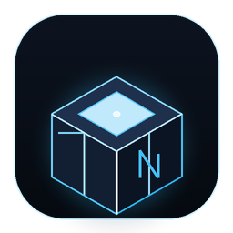

<div align="center">

<br>

# NanoRp-Creator

**Ультралегкая студия создания ресурс-паков Minecraft, умного исправления четности текстур и генерации постоянных ссылок без API-ключей.**

[](https://github.com/NanoDev1488/NanoRp-Creator)
[](https://github.com/NanoDev1488/NanoRp-Creator)
[](https://github.com/NanoDev1488/NanoRp-Creator)
[](https://github.com/NanoDev1488/NanoRp-Creator)
[](https://github.com/NanoDev1488/NanoRp-Creator)

Minecraft Java 1.6 — 1.21.x · Spigot · Paper · Purpur · Velocity · Fabric · Vanilla

[📢 Telegram-канал обновлений WineSquad](https://t.me/WineSquad) · [💬 Обратная связь автора](https://t.me/radoqi)

> 🚀 **Первое десктопное приложение автора (NanoDev)** на гибридном высокопроизводительном стеке Electron + Rust + C++17.

</div>

---

## 💎 Ключевые особенности в плитках

<table>
  <tr>
    <td width="33%" valign="top">
      <h3>⚡ C++17 & Rust Core</h3>
      <p>Двухдвижковая нативная архитектура. Rust отвечает за мгновенную валидацию PNG-хедеров и потоковое ZIP-сжатие, а C++17 — за верификацию структуры ресурс-пака, путей и генерацию моделей. Никаких лагов и подвисаний JS event loop.</p>
    </td>
    <td width="33%" valign="top">
      <h3>🔍 Умный Parity Extender (+1px)</h3>
      <p>Minecraft строго требует кратные 2 размеры текстур (16x16, 32x32, 64x64). Если размер нечетный (63x64 или 64x63), программа в 1 клик умным алгоритмом расширяет край на 1 пиксель (Edge Clamp), не искажая спрайт и пиксельную сетку.</p>
    </td>
    <td width="33%" valign="top">
      <h3>☁️ Облачный Линкер без Ключей</h3>
      <p>Упаковывает ресурс-пак в .ZIP, рассчитывает точный SHA-1 хеш и загружает на бесплатные открытые хостинги в 1 клик. Сразу выдает готовую строчку для вставки в <code>server.properties</code>.</p>
    </td>
  </tr>
  <tr>
    <td width="33%" valign="top">
      <h3>🔤 Визуальный Редактор Шрифтов</h3>
      <p>Заменяйте текст и эмодзи (например <code>:coin:</code>, <code>:heart:</code> или <code>\uE001</code>) на картинки в чате и скорбордах без ручного редактирования <code>font/default.json</code>.</p>
    </td>
    <td width="33%" valign="top">
      <h3>⚔️ CustomModelData Менеджер</h3>
      <p>Наглядная привязка 3D-моделей и текстур к базовым предметам (<code>diamond_sword</code>, <code>paper</code>, <code>stick</code>). Полная автогенерация overrides-предикатов.</p>
    </td>
    <td width="33%" valign="top">
      <h3>🧹 35-Этапный Debloater</h3>
      <p>Специальная сборка Electron с удалением сотен мегабайт мусора Chromium: потребление RAM снижено до рекордных ~40-50 МБ, идеальная отзывчивость на слабых процессорах (Pentium / Celeron, 4 ГБ ОЗУ).</p>
    </td>
  </tr>
</table>

---

## 🚀 Быстрый старт для пользователей

### 1. Создание ресурс-пака
1. Запустите **NanoRp-Creator**.
2. Во вкладке **«Проект & Облако»** нажмите **«Выбрать папку пака»**.
3. Укажите название, целевую версию Minecraft (от 1.6 до 1.21.x) и описание пака (поддерживаются цветовые коды, например `§b` или `§a`).
4. Нажмите **«Собрать структуру»**.

### 2. Исправление нечетных размеров картинок (Кратность 2)
1. Перейдите во вкладку **«Четность картинок»**.
2. Нажмите **«Выбрать картинки»** или **«Сканировать папку»**.
3. Программа мгновенно проверит ширину и высоту каждого спрайта:
   - Зеленый бейдж: размер делится на 2 (например `64x64`) — всё отлично.
   - Оранжевый бейдж: размер нечетный (например `63x64`).
4. Нажмите **«Расширить на +1px»** напротив файла или **«Исправить ВСЕ нечетные»**: программа бережно дорастит краевые пиксели без искажения пропорций рисунка.

### 3. Замена текста на кастомные иконки и глифы
1. Откройте вкладку **«Замена символов»**.
2. Введите желаемый символ или шорткод (например `:coin:`).
3. Выберите файл картинки `.png`, укажите высоту (обычно `8`) и подъем (обычно `7`).
4. Нажмите **«Сохранить»**: файл `assets/minecraft/font/default.json` сформируется автоматически.

### 4. Экспорт и получение ссылки для сервера
1. Нажмите **«Упаковать в ZIP»** для сохранения архива на компьютер.
2. Либо нажмите **«Залить в Облако»**: программа загрузит архив на открытый хостинг без регистрации и API-ключей, выдаст прямую ссылку и посчитает точный `resource-pack-sha1`.
3. Скопируйте готовый блок в `server.properties`:
   ```properties
   resource-pack=https://litterbox.catbox.moe/resources/internals/api.php?file=...
   resource-pack-sha1=7a18f2d59c6b8a2e1d0f5e4c3b2a1...
   ```

---

## ⚙️ Системные требования

- **ОС**: Windows 7 / 8 / 10 / 11 (x64), Linux (Ubuntu / Debian / Arch), macOS 10.15+.
- **Процессор**: Любой 2-ядерный процессор (оптимизировано под Celeron / Pentium / Core 2 Duo).
- **Оперативная память**: от 512 МБ доступной памяти (потребление приложения в работе: ~45 МБ).
- **Диск**: ~85 МБ свободного места.

---

## 🛠️ Разработка и сборка из исходников

### Требования к окружению:
- Node.js 18+ & npm
- Rust & Cargo (опционально, есть встроенный JS Fallback)
- CMake 3.15+ и C++17 компилятор (MSVC / GCC / Clang)

```bash
# Клонирование репозитория
git clone https://github.com/NanoDev1488/NanoRp-Creator.git
cd NanoRp-Creator

# Установка зависимостей
npm install

# Компиляция нативных движков (опционально)
npm run build:rust
npm run build:cpp

# Запуск в режиме разработки
npm start

# Сборка оптимизированного дистрибутива с 35 этапами очистки
npm run dist:win       # для Windows
npm run dist:linux     # для Linux
npm run dist:mac       # для macOS
```

---

## 💬 Контакты и сообщество

- **Обратная связь и предложения**: [t.me/radoqi](https://t.me/radoqi)
- **Канал обновлений WineSquad**: [t.me/WineSquad](https://t.me/WineSquad)
- **Автор**: NanoDev
